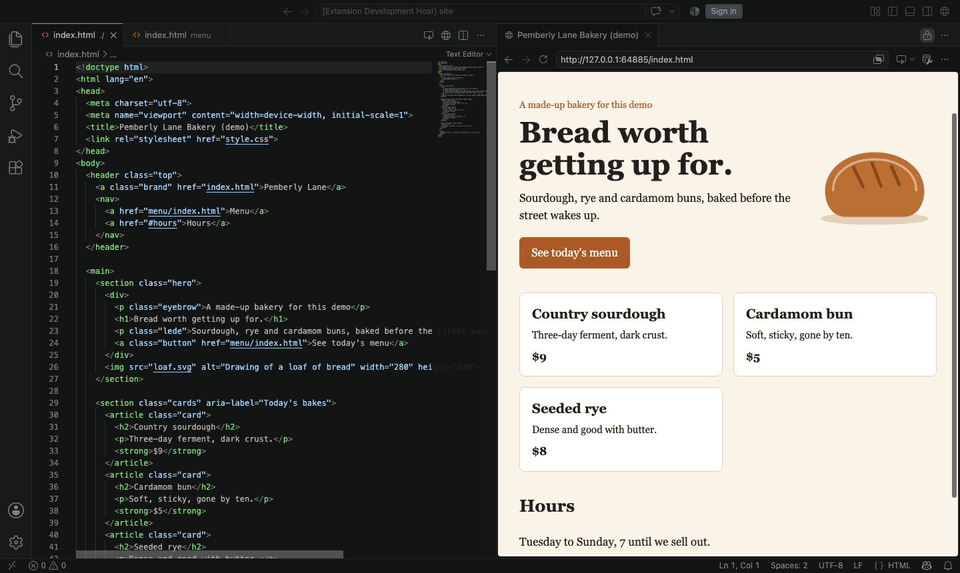
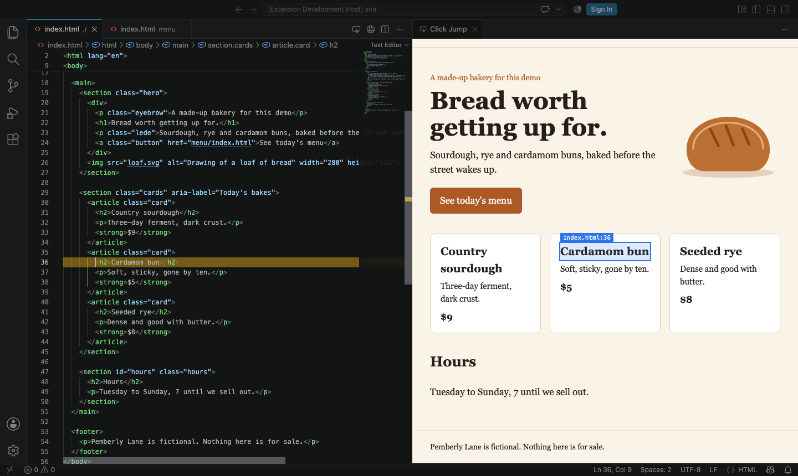

# Click Jump

I built Click Jump because I was shipping landing pages quickly and presenting them to leadership, including my CEO. Building the pages was fast. Making changes from their feedback was not, because every comment was about something on the screen and the fix was buried somewhere in a file.

Here's the kind of change that made it worth building. One landing page had a track-record section with nine deal cards in a grid. In the code, each card was one long line, and all nine looked almost identical. During a live review, my CEO asked for a change to the fourth card. Finding it meant scanning those lines while everyone waited. With Click Jump, I hold Option, click the card and land on line 374, highlighted and ready to edit. I make the change, save, and we both see it on the page.

That changes how a review works. We workshop the page together in the meeting instead of going through constant rounds of turning comments.

You may know the instinct: right-click, Inspect Element, change the text and see how it looks. But Inspect only edits the browser's copy, so the change disappears on refresh.

Click Jump makes that instinct real. Hold Option, click anything on the page, and your editor lands on the exact line that made it. Change it, save, and the page refreshes.



*Captured from a real VS Code 1.138 running the extension on the fictional bakery site in [`demo/`](demo/).*

It works on plain HTML, with no build step and no config. Your files are never rewritten: the line markers exist only in the copy sent to the browser.

## Install

**For VS Code**, paste this once:

```sh
curl -fsSLO https://github.com/anader298/click-jump/releases/latest/download/click-jump.vsix && code --install-extension click-jump.vsix
```

**For Terminal with Safari or Chrome**, paste this once (needs Node 20 or newer):

```sh
npm install --global github:anader298/click-jump
```

## Three ways to use it

### 1. VS Code with a live preview

This is the main path, and you don't type any commands after the install.

Open any HTML file and press the **Click Jump** button in the editor title bar. You can also right-click the file or run **Click Jump: Open Live Preview** from the Command Palette. The preview opens beside your code. Hold Option (Alt on Windows and Linux) and click.



*A real capture from an isolated VS Code instance.*

### 2. Mac Terminal and Safari

From any folder with an `index.html`:

```sh
click-jump --safari              # clicks open in your editor
click-jump --safari --terminal   # edit in Vim, which follows your clicks and flashes the line
```

### 3. Any terminal and any browser

```sh
click-jump                        # serves this folder, opens index.html
click-jump site/about.html        # a specific page
click-jump --browser firefox
click-jump --terminal             # Vim follows your clicks
click-jump --editor cursor
click-jump --editor "mate -l {line} {file}"
click-jump setup                  # read-only check of what it found on your machine
```

| Option | What it does |
| --- | --- |
| `--safari` | Open the preview in Safari (macOS) |
| `--browser [name]` | `safari`, `chrome`, `firefox`, `edge`, `brave`, `arc`, or an app name |
| `--terminal` | Edit in Vim in this terminal |
| `--editor <cmd>` | `code`, `cursor`, `windsurf`, `zed`, `subl`, or a template with `{file}`, `{line}`, `{col}` |
| `--port <n>` | Use this port, and fail if it is busy |
| `--no-open` | Don't open a browser |

The yellow flash happens in the VS Code extension and in `--terminal` Vim. With `--editor`, the editor jumps to the line but does not flash.


## Status

Results from the last full run on macOS (Intel), Node 26.3, on 21 November 2026.

| Suite | Result |
| --- | --- |
| Tokenizer, instrumenter, server | 160 of 160 passed |
| CLI | 21 of 21 passed |
| Browser end to end (headless Chromium, Firefox, WebKit) | 87 of 87 passed |
| Installed Google Chrome 158 | 29 of 29 passed |
| Installed Safari 18 | 7 of 7 passed, plus a real Option+click check |
| Vim in a real pseudo-terminal | 16 of 16 passed |
| Packaged `.vsix` in an isolated VS Code 1.138.0 | 20 of 20 passed |

| Platform | Status |
| --- | --- |
| macOS, VS Code | Tested |
| macOS, Chromium, Firefox and WebKit engines | Tested headless |
| Safari 18 on macOS | Tested: 7 automated checks plus real Option+clicks by hand |
| Google Chrome 158 on macOS | Tested |
| Windows | **Untested.** A CI workflow is included but has not run |
| Linux | **Untested.** A CI workflow is included but has not run |

## What it can't do

- It maps HTML files. Pages built by React, Vue or a template engine won't map back to their source components.
- Elements created by JavaScript jump to their nearest parent that exists in the HTML file.
- A page with a strict Content-Security-Policy can block the injected script.
- Remote workspaces (SSH, containers, Codespaces) are not supported.

The full list is in [docs/TESTING.md](docs/TESTING.md#known-limits).

## Security

The preview server binds to `127.0.0.1` only and uses a fresh token on every run. It checks Host and Origin, blocks path traversal and symlink escapes, won't serve dotfiles, and never passes filenames through a shell. Details are in [docs/HOW-IT-WORKS.md](docs/HOW-IT-WORKS.md#security-model).

If you point it at a single file, it serves that file's whole folder, because pages need their CSS and images. Any program running on your machine can read those files while the server is up, so don't run it in a folder of secrets.

## More

- [How it works](docs/HOW-IT-WORKS.md)
- [The story](docs/THE-STORY.md)
- [Testing](docs/TESTING.md)
- [Contributing](docs/CONTRIBUTING.md)

MIT licensed, see [LICENSE](LICENSE).
