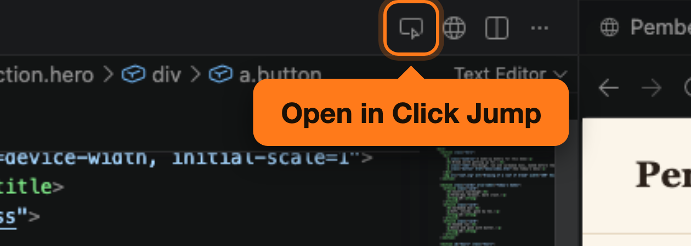
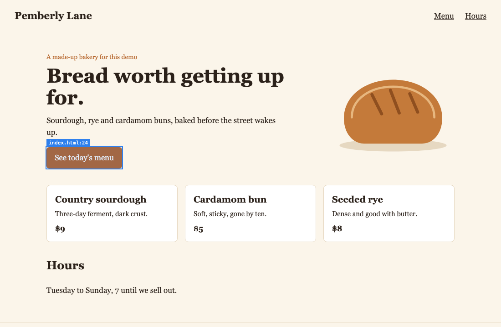

# Click Jump

**Hold Option, click anything on a web page, and VS Code jumps to the exact line of code.** Change it, save, and the page updates.


## Why I built it

I often use HTML files as a quick way to show data, results, tools and landing pages to leadership. Feedback comes while everyone is looking at the page, so I had to make changes on the spot and keep the workshop clean for a non-technical room. I couldn't find an easy, simple tool for editing and saving HTML live, so I made one. It had to be simple, light and something I didn't have to justify.

Here's the kind of change that made it worth building. One landing page had a track-record section with nine deal cards in a grid. In the code, each card was one long line, and all nine looked almost identical. During a live review, my CEO asked for a change to the fourth card. Finding it meant scanning those lines while everyone waited. With Click Jump, I hold Option, click the card and land on line 374, highlighted and ready to edit. I make the change, save, and we both see it on the page.

That changes how a review works. We workshop the page together in the meeting instead of going through constant rounds of turning comments.

You may know the instinct: right-click, Inspect Element, change the text and see how it looks. But Inspect only edits the browser's copy, so the change disappears on refresh. Click Jump makes that instinct real by taking you to the line in your actual file.

## Try it in 2 minutes

You need [VS Code](https://code.visualstudio.com/) 1.138 or newer. Click Jump uses VS Code's built-in browser, so there's nothing else to install.

**1. Download** [the extension](https://github.com/anader298/click-jump/releases/latest/download/click-jump.vsix) and [the demo website](https://github.com/anader298/click-jump/archive/refs/heads/main.zip). Unzip the demo.

**2. Install it.** In VS Code, press `Cmd+Shift+P` (`Ctrl+Shift+P` on Windows), type `Install from VSIX`, press Enter and choose `click-jump.vsix`.

**3. Open an HTML file.** Go to **File > Open Folder**, choose the `demo` folder, then click `index.html`. If VS Code asks whether you trust the folder, choose **Yes**.

**4. Click the Click Jump icon** at the top right of the code. The website opens beside it. If you don't see the icon, click once in your code.



**5. Hold Option and click anything on the website** (Alt on Windows). The code jumps to that line and flashes yellow.

**6. Change the text and press `Cmd+S`** (`Ctrl+S` on Windows). The website updates by itself.


## How it works

A small local server adds a hidden line number to every tag in the copy of the page it sends to VS Code's Integrated Browser. When you Option+click, the page sends that location back and the editor jumps there. Your files are never rewritten by the preview.



*Hold Option to see which file and line each element comes from.*

It's free, works on plain HTML with no build step or config, and has no runtime dependencies. The VS Code extension itself is 137 lines, on top of a small shared core.

## Other ways to use it

### 1. VS Code from a terminal

On a Mac:

```sh
curl -fsSLO https://github.com/anader298/click-jump/releases/latest/download/click-jump.vsix && code --install-extension click-jump.vsix
```

On Windows, in PowerShell:

```powershell
curl.exe -fsSLO https://github.com/anader298/click-jump/releases/latest/download/click-jump.vsix; code --install-extension click-jump.vsix
```

### 2. Mac Terminal and Safari

Install the command once (needs Node 20 or newer):

```sh
npm install --global github:anader298/click-jump
```

Then, from any folder with an `index.html`:

```sh
click-jump --safari              # clicks open in your editor
click-jump --safari --terminal   # edit in Vim, which follows your clicks and flashes the line
```

### 3. Any terminal and any browser

```sh
click-jump                        # serves this folder, opens index.html
click-jump site/about.html        # a specific page
click-jump --browser firefox
click-jump --terminal             # Vim follows your clicks
click-jump --editor cursor
click-jump --editor "mate -l {line} {file}"
click-jump setup                  # read-only check of what it found on your machine
```

| Option | What it does |
| --- | --- |
| `--safari` | Open the preview in Safari (macOS) |
| `--browser [name]` | `safari`, `chrome`, `firefox`, `edge`, `brave`, `arc`, or an app name |
| `--terminal` | Edit in Vim in this terminal |
| `--editor <cmd>` | `code`, `cursor`, `windsurf`, `zed`, `subl`, or a template with `{file}`, `{line}`, `{col}` |
| `--port <n>` | Use this port, and fail if it is busy |
| `--no-open` | Don't open a browser |

The yellow flash happens in the VS Code extension and in `--terminal` Vim. With `--editor`, the editor jumps to the line but does not flash.

## Status

**Tested by hand on a Mac in VS Code.** I don't own a Windows computer, so I haven't tested it by hand on Windows. Automated tests run on GitHub's Windows machines, and VS Code support there isn't confirmed yet.

Results from macOS (Intel), Node 26.3, on 22 November 2026.

| Suite | Result |
| --- | --- |
| Tokenizer, instrumenter, server | 160 of 160 passed |
| CLI | 21 of 21 passed |
| Browser end to end (headless Chromium, Firefox, WebKit) | 87 of 87 passed |
| Installed Google Chrome 158 | 29 of 29 passed |
| Vim in a real pseudo-terminal | 16 of 16 passed |
| Extension in an isolated VS Code 1.138.0 | 21 of 21 passed |
| Installed Safari 18 | 7 of 7 passed (real Option+clicks last checked on version 0.1.0) |

| Platform | Status |
| --- | --- |
| macOS, VS Code Integrated Browser | Tested by hand and automatically |
| Safari and Chrome on macOS | Tested |
| Windows | Core, CLI and browser tests passed, including Edge. **VS Code not confirmed yet** |
| Linux | Core, CLI, browser, Vim and VS Code automated tests passed |

## What it can't do

- It maps HTML files. Pages built by React, Vue or a template engine won't map back to their source components.
- Elements created by JavaScript jump to their nearest parent that exists in the HTML file.
- A page with a strict Content-Security-Policy can block the injected script.
- Remote workspaces (SSH, containers, Codespaces) are not supported.
- The extension needs VS Code 1.138 or newer, because it uses the Integrated Browser.

The full list is in [docs/TESTING.md](docs/TESTING.md#known-limits).

## Security

The preview server binds to `127.0.0.1` only and uses a fresh token on every run. It checks Host and Origin, blocks path traversal and symlink escapes, won't serve dotfiles, and never passes filenames through a shell. Details are in [docs/HOW-IT-WORKS.md](docs/HOW-IT-WORKS.md#security-model).

If you point it at a single file, it serves that file's whole folder, because pages need their CSS and images. Any program running on your machine can read those files while the server is up, so don't run it in a folder of secrets.

## More

- [How it works](docs/HOW-IT-WORKS.md)
- [The story](docs/THE-STORY.md)
- [Testing](docs/TESTING.md)
- [Contributing](docs/CONTRIBUTING.md)

MIT licensed, see [LICENSE](LICENSE).
